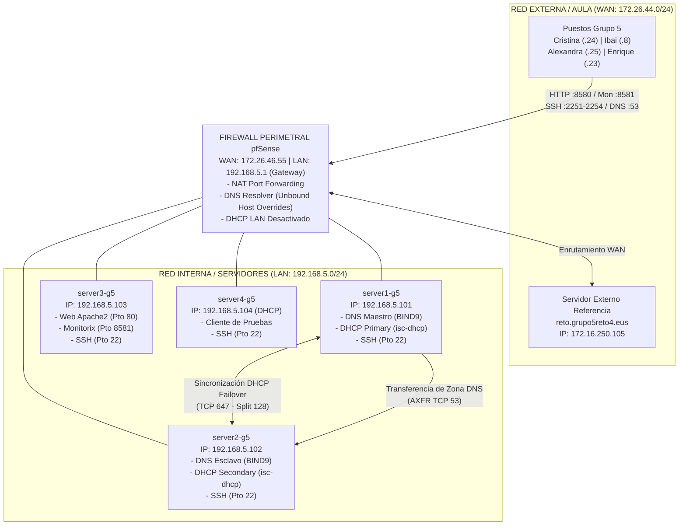

# Topología de Red y Arquitectura Lógica — Grupo 5 (Reto 4)

## 1. Visión General de la Infraestructura

La arquitectura de red del **Grupo 5** para el proyecto **Gran Premio de Euskadi - Bilbao 2026** está diseñada bajo un modelo de **segmentación perimetral y alta disponibilidad**, separando el entorno público/externo de la red privada de servidores mediante un firewall **pfSense**.

* **Segmento Externo / Aula (WAN):** `172.26.44.0/24` — Simula el acceso desde Internet y aloja los puestos de administración del equipo.
* **Segmento Interno / Servidores (LAN):** `192.168.5.0/24` — Red aislada donde operan los cuatro nodos **Ubuntu 22.04.5 LTS** virtualizados sobre **KVM/QEMU**.

---

## 2. Diagrama Visual de Topología (Compatible con GitHub Mermaid)



---

## 3. Diagrama Estructural ASCII

```text
====================================================================================================
                             RED EXTERNA / AULA (WAN: 172.26.44.0/24)
   Puestos Grupo 5: Cristina (.24), Ibai (.8), Alexandra (.25), Enrique (.23)
   Servidor externo de referencia: reto.grupo5reto4.eus -> 172.16.250.105
====================================================================================================
                                                |
                                                | IP WAN: 172.26.46.55
                                  +---------------------------+
                                  |     FIREWALL pfSense      |
                                  |  - NAT / Port Forwarding  |
                                  |  - DNS Resolver (Unbound) |
                                  |  - DHCP LAN Desactivado   |
                                  +---------------------------+
                                                | IP LAN: 192.168.5.1 (Gateway)
                                                |
------------------------------------------------+---------------------------------------------------
                                   RED INTERNA (LAN: 192.168.5.0/24)
----------------------------------------------------------------------------------------------------
          |                              |                              |                         |
+-------------------+          +-------------------+          +-------------------+     +-------------------+
|    server1-g5     |          |    server2-g5     |          |    server3-g5     |     |    server4-g5     |
| IP: 192.168.5.101 |          | IP: 192.168.5.102 |          | IP: 192.168.5.103 |     | IP: 192.168.5.104 |
+-------------------+          +-------------------+          +-------------------+     +-------------------+
| - DNS Maestro     |  AXFR    | - DNS Esclavo     |          | - Web Apache2     |     | - Cliente Linux   |
|   (BIND9)         |=========>|   (BIND9)         |          |   (Puerto 80)     |     |   (Pruebas DHCP)  |
| - DHCP Primary    | Failover | - DHCP Secondary  |          | - Monitorix       |     | - SSH (Pto 2254)  |
|   (isc-dhcp)      |<========>|   (isc-dhcp)      |          |   (Puerto 8581)   |     |                   |
| - SSH (Pto 2251)  |          | - SSH (Pto 2252)  |          | - SSH (Pto 2253)  |     |                   |
+-------------------+          +-------------------+          +-------------------+     +-------------------+
```

---

## 4. Plan de Direccionamiento IP (IPAM)

| Equipo / Host | Interfaz | Dirección IP | Máscara | Gateway | Servidores DNS | Asignación |
| :--- | :--- | :--- | :--- | :--- | :--- | :--- |
| **pfSense (WAN)** | `em0` / WAN | `172.26.46.55` | `255.255.255.0` (`/24`) | Gateway Aula | Unbound / Aula | Estática |
| **pfSense (LAN)** | `em1` / LAN | `192.168.5.1` | `255.255.255.0` (`/24`) | N/A (Enrutador) | `192.168.5.101`, `.102` | Estática |
| **server1-g5** | `eth0` | `192.168.5.101` | `255.255.255.0` (`/24`) | `192.168.5.1` | `192.168.5.101`, `.102` | Estática |
| **server2-g5** | `eth0` | `192.168.5.102` | `255.255.255.0` (`/24`) | `192.168.5.1` | `192.168.5.101`, `.102` | Estática |
| **server3-g5** | `eth0` | `192.168.5.103` | `255.255.255.0` (`/24`) | `192.168.5.1` | `192.168.5.101`, `.102` | Estática |
| **server4-g5** | `eth0` | `192.168.5.104` | `255.255.255.0` (`/24`) | `192.168.5.1` | `192.168.5.101`, `.102` | Dinámica (DHCP) |
| **Rango Pool DHCP** | LAN | `.104` – `.153` | `255.255.255.0` (`/24`) | `192.168.5.1` | `192.168.5.101`, `.102` | Pool 50 IPs (Failover) |

---

## 5. Matriz de Enrutamiento NAT y Seguridad Perimetral (pfSense)

### 5.1. Reglas de Redirección de Puertos (NAT Port Forward — WAN `172.26.46.55`)

| Protocolo | Puerto Externo (WAN) | IP Destino Interna (LAN) | Puerto Interno | Servicio Publicado |
| :--- | :--- | :--- | :--- | :--- |
| **TCP / UDP** | `53` | `192.168.5.101` | `53` | Resolución DNS Autoritativa (`grupo5reto4.eus`) |
| **TCP** | `2251` | `192.168.5.101` | `22` | Administración remota SSH (`server1-g5`) |
| **TCP** | `2252` | `192.168.5.102` | `22` | Administración remota SSH (`server2-g5`) |
| **TCP** | `2253` | `192.168.5.103` | `22` | Administración remota SSH (`server3-g5`) |
| **TCP** | `2254` | `192.168.5.104` | `22` | Administración remota SSH (`server4-g5`) |
| **TCP** | `8580` | `192.168.5.103` | `80` | Portal Web Apache2 (*GP Euskadi - Bilbao 2026*) |
| **TCP** | `8581` | `192.168.5.103` | `8581` | Panel de Monitorización del Sistema (`Monitorix`) |

### 5.2. Flujos de Comunicación Interna (LAN `192.168.5.0/24`)
* **Replicación DNS (BIND9):** `server1-g5` (`192.168.5.101`) notifica y transfiere las zonas directa (`grupo5reto4.eus`) e inversa (`5.168.192.in-addr.arpa`) exclusivamente hacia `server2-g5` (`192.168.5.102`) mediante **AXFR (TCP 53)**.
* **Sincronización DHCP Failover:** `server1-g5` (Primary) y `server2-g5` (Secondary) mantienen un canal permanente de sincronización de concesiones y estados sobre el puerto **TCP `647`** (`split 128`, `mclt 1800`).
* **Aislamiento DHCP en pfSense:** El servicio DHCP nativo de pfSense en la interfaz LAN está explícitamente desactivado para garantizar que todas las concesiones dinámicas pasen por el clúster redundante interno.